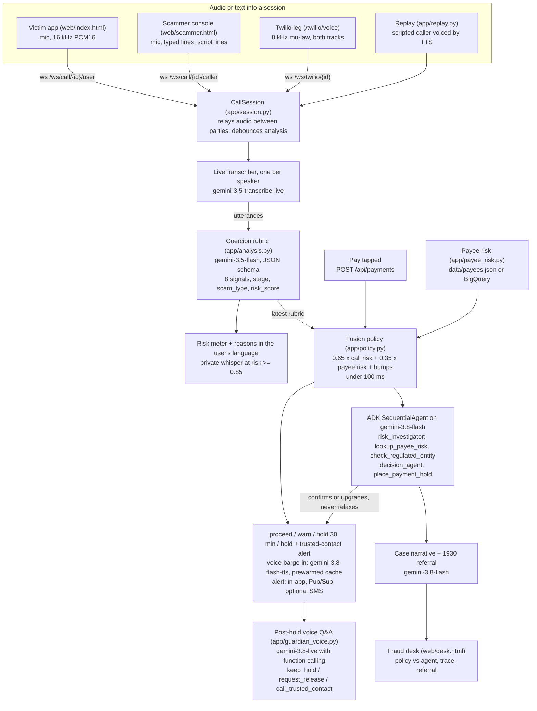

# Rakshak: scam-moment interception for bank and UPI apps

Rakshak is a guardian agent that lives inside a bank or UPI app. With the customer's opt-in it listens to a phone call, scores the caller's coercion tactics in real time with Gemini (authority impersonation, threats, secrecy, urgency, remote-app install, "safe account" transfers, investment pressure, OTP requests), and at the one moment that matters, when the customer taps Pay during that call, it fuses the live call risk with the payee's mule-account risk and the customer's own profile. The result is a graded action in under 100 ms: proceed, warn, a 30-minute hold, or hold plus a trusted-contact alert, spoken to the customer in their own language over the caller's voice. An ADK multi-agent pipeline then confirms or upgrades the decision with evidence (payee graph features, official advisories, Search grounding), never relaxes it, and files an auditable case with an auto-drafted 1930 cybercrime-helpline referral for the bank's fraud desk. The customer always keeps a one-tap override, so Rakshak is a human-in-the-loop pause, not a block.

Built for the Google Cloud AI Builder Cup 2026 (Hack2Skill, JAPAC). Everything runs on Gemini models through the Gemini API, Google ADK 2.11, and Cloud Run.

## The gap

Scam losses are increasingly "authorised push payments": the victim makes the transfer themselves while a scammer is still on the line. In Singapore, 81.8% of 2025 scam cases were self-effected transfers ([Singapore Police Force](https://www.police.gov.sg/media-hub/police-life/2026/02/scams-and-cybercrime-fell-by-almost-a-quarter-in-2025)). India lost at least Rs 22,495 crore to cyber fraud in 2025 with roughly 24% recovered ([Moneylife / MHA data](https://moneylife.in/article/fraud-alert-india-is-losing-over-22000-crore-a-year-in-cyber-scams-and-the-worst-is-yet-to-come/80612.html)); digital-arrest scams alone cost Rs 1,935.51 crore across 123,672 cases in 2024 (parliamentary data). Under MAS's Shared Responsibility Framework the liability for missed real-time controls sits with the bank, which is exactly where nothing today combines what is being said on the call with who is being paid.

| Approach | What it sees | When it acts | What it does | What it misses |
|---|---|---|---|---|
| Google Pixel / Android scam detection (on-device) | Speech patterns on the handset | During the call | Shows a warning | Warn-only and pattern-only: no payee knowledge, no hold, nothing reaches the bank |
| FICO Scam Signal, BioCatch | Whether a call is in progress, device behaviour | At payment | Raises a risk score for the bank | Call-state only: it cannot tell a daughter asking for fees from a fake CBI inspector |
| Bank transaction fraud engines | Payer, payee, amount, device | At authorisation | Blocks or steps up | Blind to the call: the coerced victim passes every step-up because they want to pay |
| Post-debit SMS alert, 1930 helpline | The completed debit | After the money left | Notifies, files a complaint | Mule accounts empty within hours; recovery in India is about 24% |
| **Rakshak** | Call semantics x payee mule risk x customer profile | At the moment of authorisation, on the bank side | Graded hold with a voice barge-in in the customer's language, trusted-contact alert, case and 1930 referral, one-tap override | Prototype limits are listed below |

## How it works



Two decision paths run at the payment moment. The deterministic fusion policy fires first and executes immediately (hold, barge-in, alert). The ADK pipeline runs in parallel; if it finishes within 6 seconds its decision is already in the HTTP response, otherwise the UI receives a `case_update` event. The agent's action is combined with the policy's as `max(agent, policy)` over the order proceed < warn < hold < hold_and_alert, so the agent can add evidence or upgrade but can never relax a hold. See [docs/ARCHITECTURE.md](docs/ARCHITECTURE.md).

## Google Cloud services

| Service | Where it is used in code | Status |
|---|---|---|
| Gemini API, `gemini-3.5-transcribe-live` | `app/analysis.py` `LiveTranscriber` (Live API, one session per speaker, text modality, `input_transcription`) | Implemented |
| Gemini API, `gemini-3.5-flash` | `app/analysis.py` `analyze_transcript` via `app/llm.py` `generate_json` (JSON schema, `thinking_level=minimal`); also the agent fallback model | Implemented |
| Gemini API, `gemini-3.8-flash` | `app/agents/pipeline.py` (both ADK agents), `app/narrative.py` (fraud-desk record), `app/agents/tools.py` (Search grounding), `app/analysis.py` `transcribe_audio_window` (batch audio helper, not wired into the live loop) | Implemented |
| Gemini API, `gemini-3.8-flash-tts` | `app/intervention.py` `tts_pcm16` with disk + memory cache and startup `prewarm` | Implemented |
| Gemini API, `gemini-3.8-live` | `app/guardian_voice.py` (audio in/out, 3 function tools) over `/ws/guardian/{case_id}` | Implemented |
| Google Search grounding | `app/agents/tools.py` `check_regulated_entity`, after the local advisory table in `app/agents/advisories.py` | Implemented |
| Google ADK 2.11 (`google-adk==2.11.0`) | `app/agents/pipeline.py`: `SequentialAgent` of two `LlmAgent`s on ADK's `Gemini` model wrapper sharing the app's genai client, `Runner`, `InMemorySessionService`, function tools in `app/agents/tools.py` | Implemented |
| Cloud Run | `Dockerfile`, `scripts/deploy.sh` (WebSockets, session affinity, 3600 s timeout, min instances) | Implemented |
| Secret Manager | `scripts/deploy.sh` creates `gemini-api-key` and mounts it with `--set-secrets` | Implemented in the deploy script |
| Vertex AI / Agent Platform endpoints | `app/llm.py` `client()` and `app/config.py` when `GOOGLE_GENAI_USE_VERTEXAI=true` (text, TTS, agents and narrative). The Live API models (`transcribe-live`, `3.8-live`) use a separate `live_client()` on the AI Studio key unless `RAKSHAK_LIVE_VIA_VERTEX=1` | Optional via env |
| Firestore (native mode) | `app/store.py` `FirestoreStore` (`rakshak_cases`, `rakshak_profiles`, `rakshak_alerts`) | Optional via `USE_FIRESTORE=true` |
| BigQuery | `app/payee_risk.py` `_from_bigquery`, `sql/payee_risk.sql` (mule features from a ledger), `scripts/load_bigquery.py` (loads the demo table) | Optional via `BIGQUERY_PAYEE_TABLE` |
| Pub/Sub | `app/alerts.py` `_publish_pubsub` (topic `rakshak-alerts`, attribute `event_type=trusted_contact_alert`) | Optional via `PUBSUB_ALERT_TOPIC` (set by the deploy script) |
| BigQuery `AI.GENERATE` | `sql/narrative_ai_generate.sql`: the same fraud-desk prompt run over the cases table | Production path documented (SQL only, the app does not execute it) |
| Vertex AI Agent Platform: Agent Runtime | `docs/ARCHITECTURE.md` scaling section | Production path documented, not implemented |
| Vertex AI Agent Platform: Memory Bank | `docs/ARCHITECTURE.md` (customer profiles and prior alerts as the personalisation store) | Production path documented, not implemented |
| Cloud Logging | Container stdout from the `rakshak.*` loggers | Implemented by default on Cloud Run |

## Quickstart

Requirements: Python 3.12, [uv](https://docs.astral.sh/uv/), and a Gemini API key from AI Studio (a free key works for every model Rakshak uses).

```bash
git clone <this repo> rakshak-agent && cd rakshak-agent
uv sync                      # installs google-adk 2.11, google-genai 2.29, fastapi, uvicorn, pytest
cp .env.example .env         # set GEMINI_API_KEY=...
uv run uvicorn app.main:app --port 8080
```

Then open:

* `http://localhost:8080/` the customer's bank app ("SafePay") with the guardian profile, call screen and UPI pay screen
* `http://localhost:8080/scammer` the caller console (join with the session id shown on the phone)
* `http://localhost:8080/desk` the bank's fraud desk
* `http://localhost:8080/api/health` reports `llm`, `live`, `vertex` and the configured model ids

On first start with a key, Rakshak pre-generates the hold, warn and whisper clips for the two demo profiles (`RAKSHAK_PREWARM_TTS=1`, cached in `data/tts_cache/`), and the pay screen asks for the clip for the exact amount as soon as it opens, so the barge-in is instant. `uv run pytest` runs the 10 offline tests (they set `RAKSHAK_FAKE_LLM=1` themselves). `uv sync --extra gcp` adds the Firestore, BigQuery and Pub/Sub clients.

Two things to know before a rehearsal: the free AI Studio tier has small daily request caps on the 3.x models (see section 6 of [docs/DEMO_STRATEGY.md](docs/DEMO_STRATEGY.md)), so enable billing on the AI Studio project or point text, TTS and agent traffic at Vertex AI with `GOOGLE_GENAI_USE_VERTEXAI=true` and `GOOGLE_CLOUD_PROJECT`; and the Live API models (transcription and the post-hold conversation) still use the AI Studio key in that mode unless `RAKSHAK_LIVE_VIA_VERTEX=1` is set, so keep the key configured.

## How to test it as a judge

Two demo customers exist: `demo-user` (Sunita Rao, 60+, Hindi, trusted contact Priya, typical transfer Rs 4,000) and `demo-user-en` (Daniel Tan, Singapore English, trusted contact Mei). Switch with the dropdown on the home screen. Every payee handle ends in `@rakshakdemo`, a suffix that does not exist on UPI.

### Flow 1: scripted scam call, then pay (the main demo)

1. Open `/`, tap **Simulate incoming call**.
2. Pick **Parcel from Taiwan (CBI digital arrest, Hindi)** and tap **Auto-play script**. The scammer's lines are voiced on the phone (Charon voice), transcribed, and the risk meter, signal chips and Hindi reasons update after each utterance. At risk >= 0.85 a private whisper plays on the victim's device only ("Rakshak: careful...").
3. The replay stops at the `payment_demand` line and shows a toast. Tap **Open UPI pay**: the VPA `cbi.verification@rakshakdemo` and Rs 2,50,000 are pre-filled (if the pay screen was already open, the fields fill in when the demand line is reached). Tap **Pay**.
4. Expect, immediately: the hold screen with a 30:00 countdown, the payee card (critical band, 12 payers in 48 h, 96% cashed out in 7 days, 4 complaints on 1930), and "Priya (daughter) has been notified"; the screen changes first and Rakshak's Hindi voice follows over the ducked caller audio (instantly when the clip was prewarmed, otherwise as soon as TTS returns). Within a few seconds the event log shows the ADK agent confirming (`decided_by adk_agent`).
5. Try the three exits: **Talk to Rakshak (voice)** opens a Gemini Live conversation that can answer "why did you stop this?" and call `keep_hold`, `request_release` or `call_trusted_contact`; **I know this person, pay anyway** requires typing the exact amount; **Cancel payment & report** closes the case.
6. Open `/desk`: the case shows the agent decision next to the deterministic policy, the call rubric, payee evidence, the ADK trace (tool calls and results), the generated narrative and the 1930 / ASCom referral text.

### Flow 2: benign hard negative, then pay

Repeat with **Benign hard negative: daughter's hostel fee is due tonight (Hinglish)**. It is urgent and about money, and the payee `meera.s@rakshakdemo` is a low-risk account. Tap **Open UPI pay** (Rs 62,500 pre-filled) and **Pay**: expect `proceed` ("Payment sent" with the policy score) or at most a `warn`. Urgency alone is weak evidence; authority plus secrecy plus a safe-account demand is decisive.

### Flow 3: transcript-driven via curl (no browser, no audio)

```bash
BASE=http://localhost:8080
H='content-type: application/json'
curl -s -X POST $BASE/api/sessions -H "$H" -d '{"session_id":"judge1","user_id":"demo-user","mode":"text"}'
curl -s -X POST $BASE/api/sessions/judge1/turns -H "$H" -d '{"speaker":"caller","text":"Main CBI Mumbai se inspector bol raha hoon, aapke naam se parcel mein drugs pakde gaye hain."}'
curl -s -X POST $BASE/api/sessions/judge1/turns -H "$H" -d '{"speaker":"caller","text":"Aapka arrest warrant ready hai. Kisi ko mat batao, national security ka matter hai."}'
curl -s -X POST $BASE/api/sessions/judge1/turns -H "$H" -d '{"speaker":"caller","text":"Bachne ke liye abhi RBI ke safe account mein 2 lakh UPI se transfer karo, verification ke baad refund milega."}'
curl -s -X POST $BASE/api/sessions/judge1/analyze | jq '{risk_score, scam_type, stage, signals}'
curl -s -X POST $BASE/api/payments -H "$H" \
  -d '{"session_id":"judge1","vpa":"cbi.verification@rakshakdemo","payee_name":"CBI Verification","amount_inr":200000}' \
  | jq '.case | {case_id, status, policy, decision}'
curl -s $BASE/api/cases | jq '.[0] | {case_id, status, action: .decision.action, decided_by: .decision.decided_by, narrative}'
curl -s -X POST $BASE/api/cases/<case_id>/override -H "$H" -d '{"reason":"judge test"}' | jq .status
```

The `/api/payments` call waits up to `RAKSHAK_AGENT_SYNC_WAIT_S` (6 s) for the ADK agent; the deterministic decision is in the response either way. Set `RAKSHAK_FAKE_LLM=1` to run all three flows offline: the rubric becomes a keyword stub, TTS returns no audio, the agent is skipped and the narrative is a template. The test suite runs in that mode.

## Evaluation

`scripts/eval.py` scores the rubric and the fusion policy on `data/eval/calls.json`: 30 labelled calls (15 scam, 15 benign; Hindi, Hinglish, English and Singapore English; 21 include a payment attempt). It measures call-level precision, recall and F1 at the hold threshold (0.70), per-signal accuracy over the 8 signals, payment-decision accuracy of the fusion policy against the labels, and mean rubric latency. It writes `data/runtime/eval_results.json` (served at `/api/eval/latest`) and regenerates `docs/EVAL_RESULTS.md`.

```bash
uv run python scripts/eval.py            # with Gemini
uv run python scripts/eval.py --stub     # keyword stub, offline
uv run python scripts/smoke_agent.py     # one full decision path with the real ADK agent, printed to the console
```

See [docs/EVAL_RESULTS.md](docs/EVAL_RESULTS.md) for the numbers of the latest run; the file is overwritten by every run, so quote it rather than this README.

## Demo modes

1. **Replay (one device).** `POST /api/sessions/{id}/replay` plays one of the 12 scripts in `data/scripts/demo_scripts.json` (9 scam, 3 benign; Hindi, Hinglish, English, Singapore English). Caller lines are voiced with the caller TTS voice and transcribed; the user's lines are injected as text so the rubric sees both sides. Replay stops at the `payment_demand` marker by default.
2. **In-app two-device call.** The victim opens `/`, the second person opens `/scammer?session=<id>` on another device or tab and taps **Start my mic**. Audio is relayed between the two browsers (a tiny VoIP) and each leg is transcribed by its own Live session, so the transcript is labelled without diarization. The scammer can also type a line (voiced on the victim's phone) or click lines from a script.
3. **Real phone number via Twilio.** Point a Twilio number's Voice webhook at `POST https://<url>/twilio/voice?session=phone`. Twilio announces "Rakshak guardian mode is on for this call", dials `TWILIO_DIAL_NUMBER` (the "scammer" phone) and forks both tracks as 8 kHz mu-law to `/ws/twilio/phone`; the bridge resamples to 16 kHz and feeds the same transcribers. Open `/?session=phone` to watch the risk meter and pay. This is the telco-side deployment shape. Note that the hold voice plays on the app device, not into the PSTN call.

The demo run-book (the four demo layers L0 to L3, the Singapore stage script, what to record for the video, and the quota warning) is [docs/DEMO_STRATEGY.md](docs/DEMO_STRATEGY.md); the day-by-day plan to the 18 October deadline is [docs/BUILD_PLAN.md](docs/BUILD_PLAN.md).

## Deployment

```bash
PROJECT=<your-project> REGION=asia-southeast1 GEMINI_API_KEY=<key> ./scripts/deploy.sh
```

The script enables the APIs, stores the key in Secret Manager, creates the `rakshak-alerts` Pub/Sub topic, builds from source and deploys to Cloud Run (`--session-affinity --timeout 3600 --concurrency 40 --min-instances 1`), then writes the service URL back as `PUBLIC_BASE_URL` for the Twilio bridge. Firestore, BigQuery and Twilio are switched on with env vars. Step-by-step instructions, IAM roles, cost and rollback are in [docs/DEPLOYMENT.md](docs/DEPLOYMENT.md).

## Project layout

```
rakshak-agent/
  app/
    main.py              FastAPI app: pages, REST API (incl. per-amount TTS prewarm), WebSockets (/ws/events, /ws/call, /ws/guardian), lifespan tasks
    config.py            Settings from env: models, thresholds (warn 0.45, hold 0.70, whisper 0.85), hold minutes, GCP toggles, Live routing
    session.py           CallSession and SessionRegistry: audio relay, per-speaker transcribers, debounced analysis, whisper
    analysis.py          LiveTranscriber (Gemini Live), Rubric schema + prompt, keyword stub for offline mode
    llm.py               google-genai clients (Vertex or AI Studio; separate Live client), generate_json with retries
    policy.py            Deterministic fusion policy: call risk x payee risk x profile -> proceed/warn/hold/hold_and_alert
    payee_risk.py        Payee lookup: BigQuery (optional) -> data/payees.json -> thin-file default
    intervention.py      Hold/warn/whisper scripts in hi, en, en-sg, kn, ta, hinglish; TTS with cache; prewarm
    payment.py           Payment-moment orchestration: fast path, agent follow-up, policy floor, override, cancel, hold expiry, prewarm
    narrative.py         Fraud-desk narrative + 1930 referral (gemini-3.8-flash JSON)
    alerts.py            Trusted-contact alert: in-app always, Pub/Sub and Twilio SMS optional
    store.py             MemoryStore (data/runtime/*.json) and FirestoreStore
    replay.py            Scripted caller replay with TTS voice
    guardian_voice.py    Post-hold voice conversation on gemini-3.8-live with function calling
    audio.py             Resampling, WAV, G.711 mu-law
    agents/
      pipeline.py        ADK SequentialAgent: risk_investigator -> decision_agent, trace capture, fallback model
      tools.py           lookup_payee_risk, check_regulated_entity (advisories + Search grounding), place_payment_hold
      advisories.py      Official advisory table (I4C, RBI, SPF/ScamShield, MAS, SEBI, NPCI)
    telephony/twilio.py  TwiML webhook and Media Streams bridge
  web/
    index.html, app.js   Victim bank app: profile opt-in, call screen, pay screen, hold screen, override modal, voice Q&A
    scammer.html         Caller console
    desk.html            Fraud desk
    common.js, worklet.js, styles.css
  scripts/
    deploy.sh            Cloud Run deployment
    eval.py              Evaluation harness
    load_bigquery.py     Creates the BigQuery payee table from data/payees.json
    smoke_agent.py       End-to-end console smoke test with the real agent
  sql/
    payee_risk.sql       Mule-risk feature query over a transaction ledger
    narrative_ai_generate.sql  BigQuery AI.GENERATE version of the fraud-desk record
  data/
    eval/calls.json      30 labelled synthetic calls
    scripts/demo_scripts.json  12 demo scripts with markers and payment attempts
    payees.json          60 synthetic payees with mule features (31 low, 11 medium, 6 high, 12 critical)
    runtime/             cases.json, profiles.json, alerts.json, eval_results.json (git-ignored)
    tts_cache/           cached guardian audio (git-ignored)
  tests/                 10 offline tests (API flow, policy, audio helpers)
  docs/                  ARCHITECTURE, DEPLOYMENT, DECK_OUTLINE, SECURITY_PRIVACY, EVAL_RESULTS, DEMO_STRATEGY, BUILD_PLAN
  Dockerfile, pyproject.toml, uv.lock, .env.example
```

## Security and privacy

* **Opt-in.** Guardian mode is a per-customer profile flag with a visible "Rakshak ON/OFF" pill; listening only starts when the customer taps "Use my mic" (browser permission prompt) or plays a script. The flag gates the in-call whisper.
* **No audio retention by default.** Call audio is streamed to the Gemini Live transcriber and relayed to the other party; nothing is written to disk. `RAKSHAK_RETAIN_AUDIO` exists in the settings and defaults to false; the current code does not record even when it is set. Only Rakshak's own synthesised voice is cached.
* **What is kept.** A transcript excerpt (up to 2,500 characters), the rubric, the payee evidence, the decision, the agent trace and the narrative are stored on the case for audit and for the 1930 referral.
* **Secrets.** The Gemini key is read from the environment locally and from Secret Manager on Cloud Run; `.env` is git-ignored.
* **Synthetic data only.** All payees, calls, scripts, names and phone numbers are invented; payee handles use the non-existent `@rakshakdemo` suffix.
* **Safeguards against over-blocking.** One-tap override with a typed-amount confirmation, automatic hold expiry after 30 minutes, and the agent can only ever make the policy's action stricter.

Details, DPDP Act and MAS considerations, and the production client path (Firebase App Check and Firebase Auth) are in [docs/SECURITY_PRIVACY.md](docs/SECURITY_PRIVACY.md).

## Limitations and roadmap

* **Synthetic payee table.** `data/payees.json` is hand-built. `sql/payee_risk.sql` shows how the same features (fan-in, cash-out ratio, dormancy burst, telecom FRI, 1930 complaints, KYC tier) are derived from a real ledger, but no bank data was used.
* **No real payment rails.** "Proceed", "hold" and "override" change the case status only; nothing moves money. A hold that expires becomes `hold_expired`; the app does not auto-release a payment.
* **Live transcription emits per utterance.** `gemini-3.5-transcribe-live` returns text in utterance-sized chunks and the session appends each as a turn; the 1.2 s debounce and 3 s minimum interval keep the rubric calls bounded, but a long sentence can land as two turns.
* **Search grounding quota.** `check_regulated_entity` falls back to Google Search grounding only when the local advisory table has no match, with an 8 s timeout; on quota errors the verdict is `unclear` and the policy floor still applies.
* **Kannada and Tamil voice untested.** Hold and whisper scripts exist for `kn` and `ta`, but the TTS output in those languages has not been reviewed by native speakers; warn scripts fall back to English for them.
* **Free-tier quota.** On a free AI Studio key the 3.x models have small daily request caps (one rehearsal can exhaust `gemini-3.8-flash`); see the quota note in `docs/DEMO_STRATEGY.md`. Billing on the AI Studio project or the Vertex AI path removes the cap.
* **Live API through Vertex AI is untested.** With `GOOGLE_GENAI_USE_VERTEXAI=true` the transcription and post-hold conversation still use the AI Studio key by default; `RAKSHAK_LIVE_VIA_VERTEX=1` exists but has not been exercised.
* **Prototype security posture.** Endpoints are unauthenticated and CORS is open; see the production path in the security doc.
* **Roadmap.** Real mule features from the bank ledger through `sql/payee_risk.sql`; move the ADK pipeline to Vertex AI Agent Runtime and customer profiles to Memory Bank; bidirectional Twilio stream so the barge-in reaches the phone call; native-speaker review of Kannada and Tamil; a bank pilot behind Firebase Auth and App Check.

## License and team

MIT License (add the `LICENSE` file to the repository root before submission; the repo does not contain one yet).

Team: _add names, roles and contact here before submission_.
