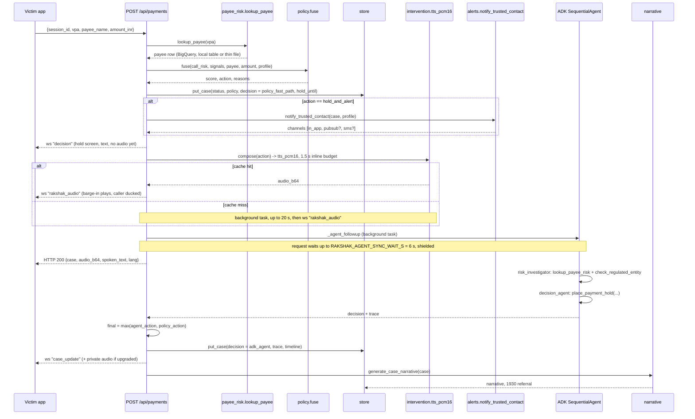

# Rakshak architecture

This document describes what is in the repository today, component by component, and separates the implemented runtime from the documented production paths. Line references are to the files under `app/`.

## Design principles

1. **Decide fast, explain slower.** The deterministic fusion policy decides and acts in under 100 ms. The ADK agent pipeline runs in parallel to add evidence, and may only make the action stricter (the policy floor).
2. **One transcription session per speaker.** Each party's audio goes to its own `gemini-3.5-transcribe-live` session, so the transcript is labelled `caller:` and `user:` without diarization.
3. **The user's language everywhere.** Rubric reasons, the barge-in, the agent's message, the Live conversation and the customer follow-up are produced in the customer's profile language (hi, en, en-sg, kn, ta, hinglish).
4. **Everything degrades.** No key, no network, no Firestore, no BigQuery, no Pub/Sub, no Twilio: each has a local fallback and the demo still runs.
5. **Human in the loop by construction.** A hold is a pause with a one-tap override and an expiry, never a block.

## Components

### `config.py`: settings

A pydantic `Settings` object built from environment variables (`.env` is loaded by `main.py`). Highlights:

| Setting | Default | Meaning |
|---|---|---|
| `GEMINI_API_KEY` / `GOOGLE_API_KEY` | none | AI Studio key; `configure_env()` normalises it to `GOOGLE_API_KEY` so google-genai and ADK share it |
| `GOOGLE_GENAI_USE_VERTEXAI` | false | Route text, TTS, agent and narrative calls to Vertex AI / Agent Platform endpoints with `GOOGLE_CLOUD_PROJECT` and `GOOGLE_CLOUD_LOCATION` (default `global`; this is the model location, not the Cloud Run region). `configure_env()` then removes the API key from the environment so ADK and google-genai cannot fall back to it |
| `RAKSHAK_LIVE_VIA_VERTEX` | false | The Live API models are published under their ids on the Gemini API, so `live_client()` uses the AI Studio key by default even when Vertex is selected; set this to route Live through Vertex too (needs the Vertex Live model ids). `live_enabled()` = `llm_enabled()` and (API key present or this flag) |
| `RAKSHAK_ACCESS_TOKEN` | unset | Local development only: an OAuth access token (`gcloud auth print-access-token`) used by `client()` when Vertex is selected and no Application Default Credentials exist |
| `RAKSHAK_FAKE_LLM` | false | Offline keyword stub; `llm_enabled()` is false |
| `RAKSHAK_MODEL_RUBRIC` | `gemini-3.5-flash` | Coercion rubric |
| `RAKSHAK_MODEL_AGENT` / `_FALLBACK` | `gemini-3.8-flash` / `gemini-3.5-flash` | ADK agents and Search grounding |
| `RAKSHAK_MODEL_NARRATIVE` | `gemini-3.8-flash` | Fraud-desk record |
| `RAKSHAK_MODEL_TRANSCRIBE_LIVE` | `gemini-3.5-transcribe-live` | Per-speaker live transcription |
| `RAKSHAK_MODEL_AUDIO_BATCH` | `gemini-3.8-flash` | Batch audio-window helper (defined, not wired) |
| `RAKSHAK_MODEL_TTS` | `gemini-3.8-flash-tts` | Barge-in and scripted caller voice (voices `Kore` and `Charon`) |
| `RAKSHAK_MODEL_LIVE` | `gemini-3.8-live` | Post-hold voice conversation |
| `warn_threshold` / `hold_threshold` / `whisper_threshold` | 0.45 / 0.70 / 0.85 | Policy and in-call whisper thresholds (warn and hold can be overridden per profile) |
| `analysis_debounce_s` / `analysis_min_interval_s` | 1.2 / 3.0 | Rubric scheduling |
| `RAKSHAK_HOLD_MINUTES` | 30 | Cooling-off period |
| `RAKSHAK_AGENT_SYNC_WAIT_S` / `RAKSHAK_AGENT_TIMEOUT_S` | 6 / 60 | How long `/api/payments` waits for the agent, and the agent's hard timeout |
| `RAKSHAK_RUBRIC_THINKING` / `RAKSHAK_AGENT_THINKING` | `minimal` / `low` | `thinking_level` passed to the models |
| `RAKSHAK_RETAIN_AUDIO` | false | Declared; the code never writes call audio to disk regardless |
| `BIGQUERY_PAYEE_TABLE`, `USE_FIRESTORE`, `FIRESTORE_PREFIX`, `PUBSUB_ALERT_TOPIC` | unset / false / `rakshak` / unset | Optional Google Cloud data services |
| `TWILIO_*`, `PUBLIC_BASE_URL` | unset | Telephony bridge and SMS |

### `main.py`: API, pages and WebSockets

FastAPI app with open CORS, static files under `/static`, and three pages (`/`, `/scammer`, `/desk`). Lifespan tasks: TTS prewarm for the default profiles (when a key is present and `RAKSHAK_PREWARM_TTS=1`) and a 30-second loop that expires holds.

REST:

| Method and path | Purpose |
|---|---|
| `GET /healthz` | `ok`, `llm`, `live`, `vertex`, `project`, model ids |
| `POST /api/sessions`, `GET /api/sessions`, `GET /api/sessions/{id}` | Create or inspect a call session (`mode`: audio, text, replay, eval) |
| `POST /api/sessions/{id}/turns` | Transcript-driven input (`speaker` caller or user, `text`, optional `t`) |
| `POST /api/sessions/{id}/analyze` | Run the rubric now and return it |
| `POST /api/sessions/{id}/replay`, `/replay/stop` | Scripted replay (`script_id`, `voice`, `pace`, `stop_at_marker`) |
| `POST /api/sessions/{id}/say` | Inject one line as caller (voiced to the victim device) or user |
| `POST /api/sessions/{id}/end` | End the call, stop transcribers |
| `GET /api/scripts`, `GET /api/scripts/{id}` | Demo scripts |
| `POST /api/sessions/{id}/prewarm?amount_inr=` | Synthesise and cache the hold and warn clips for this customer and amount in the background (the pay screen calls it when it opens and when the amount changes) |
| `POST /api/payments` | The payment moment (`session_id`, `vpa`, `payee_name`, `amount_inr`, `use_agent`) |
| `POST /api/cases/{id}/override`, `/cancel` | Customer actions on a case |
| `GET /api/cases`, `GET /api/cases/{id}` | Cases for the fraud desk (private `_` keys stripped) |
| `GET /api/alerts` | Trusted-contact alert feed |
| `GET/PUT /api/profiles/{user_id}` | Guardian profile (language, trusted contact, `guardian_enabled`, thresholds) |
| `GET /api/payees`, `GET /api/payees/{vpa}` | Payee risk table |
| `GET /api/tts?text=` | TTS helper |
| `GET /api/eval/latest` | Last evaluation run |

WebSockets:

| Path | Direction and payload |
|---|---|
| `/ws/events/{session_id}` or `/ws/events/all` | Server to UI JSON events: `hello`, `call_started`, `transcript`, `risk_update`, `whisper`, `decision`, `agent_running`, `case_update`, `replay_*`, `party_joined`, `party_left`, `call_ended`, `analysis_error` |
| `/ws/call/{session_id}/{user or caller}` | Client to server: binary 16 kHz mono PCM16 frames, or JSON `text_turn` / `end_call`. Server to client: binary = the other party's audio; JSON `rakshak_audio` (private barge-in or whisper) and `caller_audio` (scripted caller line) with base64 PCM |
| `/ws/guardian/{case_id}` | Post-hold voice conversation: binary PCM both ways (16 kHz up, 24 kHz down), JSON `guardian_ready`, `guardian_text`, `user_text`, `interrupted`, `tool`, `error` |
| `/ws/twilio/{session_id}` | Twilio Media Streams JSON (`start`, `media`, `stop`) |

### `session.py`: `CallSession` and `SessionRegistry`

A `CallSession` holds the live state of one guarded call: turns, the latest `Rubric`, rubric history, the last 500 events (audio stripped), case ids, UI sockets, audio sockets per role, one `LiveTranscriber` per role, and whether the whisper has fired. Responsibilities:

* `feed_audio(role, pcm)` starts a transcriber for that role on first audio (only when `live_enabled()`), feeds it, and relays the frame to the other party's socket.
* `add_turn()` appends a turn, broadcasts it, and schedules a debounced analysis (cancel-and-restart on every new turn, 1.2 s debounce, at least 3 s between rubric calls).
* `run_analysis()` calls the rubric on the full transcript, broadcasts `risk_update`, and fires the private whisper once when risk >= 0.85 and the profile has `guardian_enabled`.
* `send_private_audio()` and `inject_caller_audio()` deliver audio to one party only.

`SessionRegistry` is an in-process dict of sessions plus the global fraud-desk sockets. Sessions are not persisted.

### `analysis.py`: live transcription and the coercion rubric

* `LiveTranscriber`: an asyncio task that opens `live_client().aio.live.connect(model=gemini-3.5-transcribe-live, LiveConnectConfig(response_modalities=["TEXT"]))`, streams `audio/pcm;rate=16000` blobs from a queue with `send_realtime_input`, and forwards each `server_content.input_transcription.text` chunk to the session. Reconnects with exponential backoff (1 s to 10 s) and counts errors, which the session snapshot exposes.
* `Rubric`: pydantic model with `language`, `scam_type` (10 classes), `stage` (7 stages), 8 boolean `signals`, `risk_score`, `reasons`, `reasons_user_language`, `summary`, `latency_ms`, `source`.
* `analyze_transcript()`: one `generate_json` call on `gemini-3.5-flash` with a strict JSON schema, a system prompt that defines each signal, warns about benign urgent calls, and gives a risk-score guidance band. The customer's age band and language are passed as context. Timeout 25 s.
* `stub_rubric()`: keyword regexes (English and Devanagari) that produce the same `Rubric` shape when `RAKSHAK_FAKE_LLM=1`.
* `transcribe_audio_window()`: a batch helper that sends a WAV window to `gemini-3.8-flash` and returns labelled utterances. It is implemented but not called by the session loop.

### `llm.py`

Two lazily created `genai.Client`s. `client()` serves text, JSON, TTS, Search grounding and (through ADK's `Gemini` wrapper) the agents: `vertexai=True` with project and location when `GOOGLE_GENAI_USE_VERTEXAI` is set (optionally with `RAKSHAK_ACCESS_TOKEN` credentials for local runs without ADC), else the AI Studio key with `vertexai=False` made explicit. `live_client()` serves the two Live API models: the AI Studio key by default, or the same Vertex client when `RAKSHAK_LIVE_VIA_VERTEX=1`. `generate_json()` sets `response_mime_type=application/json`, `response_json_schema`, `thinking_config`, and retries twice on 429 and 5xx with a 1.5 s, 3 s backoff. `generate_text()` is a plain helper, currently unused.

### `policy.py`: the deterministic fusion

```
payee_risk = payee.mule_risk_score or 0.3          # thin-file default for unknown payees
score = 0.65 * call_risk + 0.35 * payee_risk
+0.10 if safe_account or otp_or_credential_request
+0.05 if authority_impersonation and threat_of_arrest_or_harm
+0.10 if payee.risk_band in {critical, high} and call_risk >= 0.5
+0.05 if amount >= 50,000
+0.05 if amount >= 5 x profile.typical_transfer_inr
clamp to [0, 1]
action = hold_and_alert if score >= hold_t and profile has trusted_contact_name
       = hold           if score >= hold_t
       = warn           if score >= warn_t
       = proceed        otherwise
```

`hold_t` and `warn_t` come from the profile (defaults 0.70 and 0.45). Each bump adds a human-readable reason; `linked_complaints_1930` adds a reason without changing the score. The function is pure and is unit-tested in `tests/test_policy_and_audio.py`.

### `payee_risk.py`

`lookup_payee(vpa)`: if `BIGQUERY_PAYEE_TABLE` is set, a parameterised `SELECT * ... WHERE LOWER(vpa) = @vpa` on BigQuery (synchronous, errors fall through); else `data/payees.json` (60 rows, cached); else a thin-file record (`mule_risk_score 0.3`, band `medium`). Rows carry `account_age_days`, `fan_in_48h`, `fan_out_48h`, `inflow_48h_inr`, `cash_out_ratio_7d`, `dormant_days_before_burst`, `avg_ticket_inr`, `fri_level` (telecom Financial Risk Indicator), `linked_complaints_1930`, `kyc_tier`, `mule_risk_score`, `risk_band`, `reasons`, and `source` (`bigquery`, `local_table`, `unknown`).

### `intervention.py`: what Rakshak says and how it is voiced

Template scripts per language for hold, warn and whisper (Hindi, English, Singapore English, Kannada, Tamil, Hinglish; warn has no kn/ta template and falls back to English). `compose(action, profile, amount, minutes)` fills `{amount}` (formatted as lakh rupees or S$), `{contact}` and `{minutes}`. `tts_pcm16(text, voice)` returns 16 kHz PCM16: memory cache, then `data/tts_cache/<sha1>.wav`, then one `generate_content` on `gemini-3.8-flash-tts` with `response_modalities=["AUDIO"]` and a prebuilt voice; the source rate (24 kHz) is resampled to 16 kHz. `prewarm()` generates the hold_and_alert and warn clips for amounts 200,000 and 50,000 plus the whisper, for every default profile, at startup. `prewarm_amount(profile, amount)` generates the hold_and_alert and warn clips for one exact amount; `payment.prewarm_for` wraps it and is triggered by the `/prewarm` endpoint (pay screen) and by `replay.start_replay` for the script's payment amount.

### `payment.py`: the payment moment

`evaluate_payment(session, vpa, payee_name, amount, use_agent)`:

1. Reads the profile, the session's latest rubric (empty rubric if none), and the payee row.
2. Runs `policy.fuse` and composes the scripted message.
3. Creates the case (`case_<10 hex>`) with status `approved`, `warned` or `on_hold`, `hold_until`, the rubric, a transcript excerpt (last 2,500 characters), the payee row, the policy result, the fast-path decision (`decided_by: policy_fast_path`, `agent_status: pending | skipped`) and a timeline. Stores it.
4. Executes, in this order: the trusted-contact alert for `hold_and_alert`; a `decision` broadcast to the UI with the case and the text but no audio, so the screen changes before anything else; then the voice. For warn and hold it waits at most 1.5 s for `tts_pcm16` (a cache hit returns in milliseconds and the audio goes both into the HTTP response and as a private `rakshak_audio` message to the customer's device); on a cache miss the synthesis continues in a background task (20 s limit) and the audio is sent privately when ready. The hold is therefore never delayed by TTS.
5. If the agent is pending (LLM enabled, `use_agent`, and session mode is not `eval`), starts `_agent_followup` as a background task and waits up to 6 s for it, shielded, so a slow agent never delays the hold.

`_agent_followup` runs the ADK pipeline, then applies the floor (next section), re-speaks and re-alerts if the action was upgraded to a hold, stores the trace, broadcasts `case_update`, and generates the narrative. `override_case` and `cancel_case` set `overridden_by_user` / `cancelled_by_user`, append to the timeline and regenerate the narrative. `expire_holds` marks `on_hold` cases past `hold_until` as `hold_expired`. `prewarm_for(session, amount)` pre-synthesises the clips for an amount before the customer taps Pay.

### `agents/`: the ADK pipeline

`pipeline.py` builds a `SequentialAgent("rakshak_payment_guardian")` with two `LlmAgent`s on `gemini-3.8-flash` (`thinking_level=low`), both using ADK's `Gemini` model wrapper constructed with the app's own `genai` client so the agents share the same credentials and endpoint (Vertex or AI Studio) as the rest of the app:

* `risk_investigator` with tools `lookup_payee_risk` and `check_regulated_entity`, instructed to call both in its first turn and write a findings note of at most 120 words into state key `risk_findings`.
* `decision_agent` reading `{risk_findings}`, instructed with the same graded policy in words, required to call `place_payment_hold` exactly once with the action, hold minutes, trusted-contact flag, confidence, up to 4 reasons and a `user_message` in the customer's language.

A `Runner` per model id with a shared `InMemorySessionService`; one ADK session per case and model. Every event is summarised into a trace (`tool_call`, `tool_result`, `text`) that is stored on the case and rendered on the fraud desk. `run_payment_guardian` retries once on `gemini-3.5-flash` when the first run fails for a reason other than timeout.

`tools.py` holds the three function tools (ADK derives the schema from signature and docstring) and a `ContextVar` carrying the current case so tools can read the profile and record the decision without globals. `check_regulated_entity` first matches the caller's claimed organisation against `advisories.py` (I4C, RBI Kehta Hai, SPF/ScamShield/MAS, SEBI, NPCI entries with official source URLs); only an unmatched organisation triggers one `generate_content` on `gemini-3.8-flash` with `GoogleSearch` grounding, an 8 s timeout, and grounding chunks returned as sources.

### `narrative.py`

After the agent (or immediately when the agent is skipped) one `generate_json` on `gemini-3.8-flash` turns a slimmed case into `narrative`, `referral_text` (for the 1930 helpline / ASCom), `evidence_points`, `recommended_bank_actions` and `customer_followup_user_language`. Offline, a template stub is used. `sql/narrative_ai_generate.sql` is the same prompt expressed as BigQuery `AI.GENERATE` over a cases table.

### `alerts.py`

`notify_trusted_contact` builds the alert text, always records it in the in-app feed, publishes to Pub/Sub when `PUBSUB_ALERT_TOPIC` is set, and sends an SMS via the Twilio REST API when the three Twilio variables and a contact phone exist. The `channels` list on the alert records what succeeded.

### `store.py`

`MemoryStore` keeps cases, profiles and alerts in memory and writes `data/runtime/{cases,profiles,alerts}.json` on every change so a demo survives a restart. Unknown user ids receive a copy of the `demo-user` profile. `FirestoreStore` subclasses it: same interface, loads `rakshak_cases` and `rakshak_profiles` at startup, and writes through to Firestore on every `put_case`, `put_profile` and `add_alert` (it also still writes the local JSON). If Firestore initialisation fails, the app logs a warning and uses `MemoryStore`.

### `replay.py`, `guardian_voice.py`, `telephony/twilio.py`, `audio.py`

* `replay.py`: loads the 12 scripts, starts a background prewarm of the guardian clips for the script's payment amount, injects caller lines (voiced with the `Charon` voice to the victim device, then analysed) and user lines as text, broadcasts markers, and pauses at `payment_demand` with the script's `payment_attempt` so the pay screen can pre-fill.
* `guardian_voice.py`: requires `live_enabled()` (otherwise the socket receives an `error` saying the Live API is not configured), then opens `gemini-3.8-live` through `live_client()` with `response_modalities=["AUDIO"]`, a system prompt built from the case, three function declarations (`keep_hold`, `request_release`, `call_trusted_contact`), and input and output transcription. Tool calls are forwarded to the app as `tool` events (the app opens the override dialog on `request_release`) and answered with a `FunctionResponse`.
* `telephony/twilio.py`: `POST /twilio/voice` returns TwiML that starts a Media Stream fork of both tracks to `/ws/twilio/{session}`, says "Rakshak guardian mode is on for this call", and dials `TWILIO_DIAL_NUMBER` (or pauses 600 s). The WebSocket handler decodes mu-law, resamples 8 kHz to 16 kHz, maps `inbound` to `user` and `outbound` to `caller`, and feeds the session without relay.
* `audio.py`: numpy resampling, WAV framing, G.711 mu-law encode/decode, mixing and RMS helpers.

### `web/`

Plain HTML and JavaScript, no build step. `index.html` + `app.js` is the customer's phone: home (balance, profile with the Guardian opt-in checkbox and language), call screen (risk meter, signal chips, reasons in the user's language, transcript, script auto-play, mic), pay screen, hold screen (countdown, spoken text, reasons, payee card, alert line, three actions, voice conversation box, override modal with typed-amount confirmation) and done screen. `scammer.html` joins a session as `caller`, streams the mic, types lines, and plays scripts. `desk.html` subscribes to `/ws/events/all` and renders every case with decision vs policy, rubric, payee evidence, ADK trace, narrative and referral, plus a "what an SMS alert would have done" comparison. `common.js` has the `Player` (scheduled PCM playback with ducking), `Mic` (AudioWorklet capture, downsampled to 16 kHz) and WebSocket helpers.

## Data flow

**Call phase.** Audio frames (or text turns) arrive on a session. Each speaker's audio goes to its own Live transcription session; utterances become turns; every turn schedules a debounced rubric call; each rubric result is broadcast as `risk_update` to the phone, the caller console and the fraud desk; at risk >= 0.85 the phone receives a private whisper (TTS, cached).

**Payment phase.** `POST /api/payments` runs the fast path and responds; the agent path runs in the background; see the sequence diagram below.

**After the decision.** The customer cancels, overrides or talks to Rakshak over Live; the fraud desk sees the case, the trace and the narrative; holds expire after 30 minutes.

## The two decision paths

### Fast path: `policy.fuse`

Pure arithmetic over the latest rubric, the payee row and the profile (formula above). It runs synchronously inside the request, the case is stored, the alert is sent, and the `decision` event reaches the phone before any TTS call is made; the voice follows within milliseconds on a cache hit (prewarmed at startup, when the pay screen opens, or when a replay starts) or as a separate private message on a miss. The case is stored with `decided_by: policy_fast_path` and `latency_ms: 0`.

### Agent path: ADK `SequentialAgent`

Runs for every payment when a key is configured, `use_agent` is true and the session is not in `eval` mode. Its output replaces the reasons, confidence and `user_message` with evidence-grounded ones and records `agent_action`, `policy_action`, `model` and `latency_ms` on the decision.

### The floor: never relax below the policy

In `payment.py` `_agent_followup`:

```python
ORDER = ["proceed", "warn", "hold", "hold_and_alert"]
final = ORDER[max(ORDER.index(agent_action), ORDER.index(fast["action"]))]
```

If the agent is more lenient than the policy, the policy's action stands and the reason "policy floor applied (agent said ...)" is appended. If the agent is stricter, the action is upgraded, `hold_until` is set, the hold message is spoken privately to the customer and the trusted contact is alerted if not already. `hold_and_alert` degrades to `hold` when the profile has no trusted contact. If the agent fails or times out, `agent_status` is `failed` and the fast-path decision stays in force.

## Model choices and measured latencies

Single-request timings observed during development with an AI Studio key; they are not a benchmark. The evaluation script reports its own mean rubric latency under concurrency in `docs/EVAL_RESULTS.md`.

| Stage | Model | Why | Observation |
|---|---|---|---|
| Live transcription | `gemini-3.5-transcribe-live` | Streams 16 kHz PCM and returns `input_transcription` text; one session per speaker gives labelled turns for free | Emits per utterance, so the session treats each chunk as a turn and relies on the debounce |
| Coercion rubric | `gemini-3.5-flash`, `thinking_level=minimal` | Strict JSON schema, multilingual reasons in Devanagari, Kannada, Tamil | About 2.8 s per call. `gemini-3.8-flash` at `low` took about 8.1 s, too slow between utterances. `gemini-3.5-flash-lite` took 1.2 to 1.8 s but garbled Devanagari output, so it was rejected |
| Barge-in and caller voice | `gemini-3.8-flash-tts` (`Kore` for Rakshak, `Charon` for the scripted caller) | Natural Hindi and Indian-English prosody | About 6 s to synthesise 12 s of Hindi audio, hence the disk and memory cache, the startup prewarm, the per-amount prewarm when the pay screen opens, and the screen-before-voice ordering so the hold never waits for TTS |
| ADK agents and Search grounding | `gemini-3.8-flash`, `thinking_level=low`, fallback `gemini-3.5-flash` | Best tool-use quality for the investigator and decision agents; latency is off the critical path because the fast path already acted | Typically completes within the 6 s sync window or shortly after; hard timeout 60 s |
| Fraud-desk narrative | `gemini-3.8-flash` | Quality of the auditable record matters more than speed | Generated after the agent; the desk shows a spinner until it lands |
| Post-hold conversation | `gemini-3.8-live` | Audio in and out with in-session function calling | The Live model is audio-only on output, so it is used for the conversation after a hold, not for silent listening during the call |

## Sequence: the payment moment



## State and persistence

| State | Where | Lifetime |
|---|---|---|
| Call sessions (turns, rubric, sockets, transcribers) | `SessionRegistry` in process memory | Until the process restarts; not shared across instances |
| Cases, profiles, alerts | `MemoryStore` -> `data/runtime/*.json` | Survives restarts on one machine; on Cloud Run the container filesystem is per instance and lost on redeploy |
| Cases, profiles, alerts with `USE_FIRESTORE=true` | `FirestoreStore` -> Firestore collections `rakshak_cases`, `rakshak_profiles`, `rakshak_alerts` | Durable, multi-instance |
| Guardian audio | `data/tts_cache/*.wav` + memory | Cache; regenerated on miss |
| ADK sessions | `InMemorySessionService` | Per process |
| Evaluation output | `data/runtime/eval_results.json`, `docs/EVAL_RESULTS.md` | Until the next run |

## Scaling design on Cloud Run

What the deploy script configures today, and the production shape it points to.

* **WebSockets and session affinity.** The phone, the caller console and the Twilio bridge each hold a WebSocket for the length of a call, so the service is deployed with `--timeout 3600` (Cloud Run's maximum for a WebSocket request is 60 minutes) and `--session-affinity`, so a given client keeps hitting the instance that owns its `CallSession`. Concurrency is 40 per instance; audio frames are small and the work is I/O-bound on Gemini.
* **Minimum instances.** `--min-instances 1` keeps the TTS prewarm warm and avoids a cold start on the first hold. Raise it before a demo.
* **Stateless except the session cache.** The only in-memory state that matters is the live `CallSession`. Everything decided is written to the store. In production, cases, profiles and alerts go to Firestore (`USE_FIRESTORE=true`), which makes the fraud desk and the override endpoint correct across instances; a session that lands on a second instance (affinity cookie lost) would show an empty transcript, which is why affinity plus min instances is the prototype answer and a shared session store (Firestore or Memorystore) is the production one.
* **Fan-out.** Trusted-contact alerts are published to Pub/Sub so SMS, push, a call-centre dialler or a WhatsApp sender can subscribe independently of the request path.
* **Agents on Agent Runtime (documented path).** The ADK `SequentialAgent` in `app/agents/pipeline.py` is self-contained and can be deployed to Vertex AI Agent Platform's Agent Runtime; `payment.py` would then call the deployed agent instead of the in-process `Runner`, with sessions in the managed session service and the trace available through Agent Observability. Not implemented in this repository.
* **Memory Bank for profiles (documented path).** The guardian profile (language, trusted contact, typical transfer, prior alerts, thresholds) is the personalisation input to both the policy and the agents. In production it belongs in Memory Bank keyed by customer, updated after each case (for example `prior_alerts`), with the bank's own KYC as the source of truth. Today it is a profile document in the store.
* **Payee risk at scale.** `sql/payee_risk.sql` computes the mule features from the ledger as a BigQuery table; the per-payment lookup is one parameterised query. For sub-10 ms lookups the table would be materialised into Firestore or Memorystore by a scheduled job.

## Failure modes and fallbacks

| Failure | Behaviour |
|---|---|
| No Gemini key or `RAKSHAK_FAKE_LLM=1` | Keyword stub rubric, empty TTS audio, agent skipped, template narrative; all endpoints and tests work |
| Live transcription drops or errors | `LiveTranscriber` reconnects with backoff and counts errors (visible in the session snapshot); callers can switch to the transcript-driven path (`/api/sessions/{id}/turns` or typed lines on the caller console) |
| Rubric call fails or times out (25 s, 2 retries on 429/5xx) | `analysis_error` event; the previous rubric stays in force |
| TTS slower than 1.5 s at the payment moment | The hold screen is already up; the voice arrives as a private `rakshak_audio` message when synthesis finishes (20 s limit); `audio_b64` in the HTTP response is null |
| TTS fails | The screen shows the spoken text; no audio |
| Vertex selected without an AI Studio key | Rubric, TTS, agents and narrative run through Vertex; `live` is false on `/healthz`, no transcriber is started for audio (use the transcript-driven path or typed lines), and the post-hold conversation socket returns an `error` until `RAKSHAK_LIVE_VIA_VERTEX=1` or a key is provided |
| ADK run fails | Retry once on `gemini-3.5-flash`; if that fails, `agent_status: failed` and the policy decision stands |
| ADK run exceeds 60 s | Trace records the timeout; no retry; policy decision stands |
| Agent is more lenient than policy | Policy floor; reason appended |
| Search grounding unavailable or over quota (8 s timeout) | `check_regulated_entity` returns `unclear`; the local advisory table already covers the common claimed authorities |
| BigQuery lookup fails | Falls back to `data/payees.json`, then to the thin-file default (0.3) |
| Firestore unavailable at startup | Falls back to `MemoryStore` with a warning |
| Pub/Sub publish or Twilio SMS fails | Alert is still recorded in the in-app feed; `channels` shows what succeeded |
| Customer disagrees with a hold | One-tap override with typed amount, recorded on the case; or talk to Rakshak over Live; holds expire after 30 minutes |
